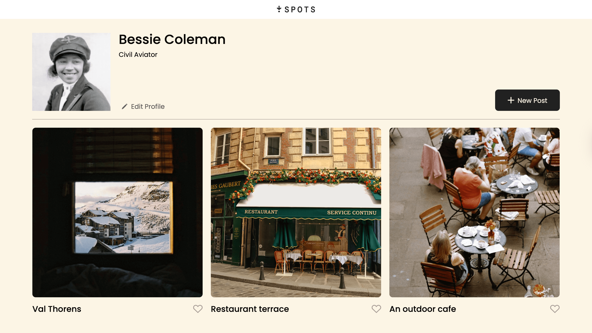
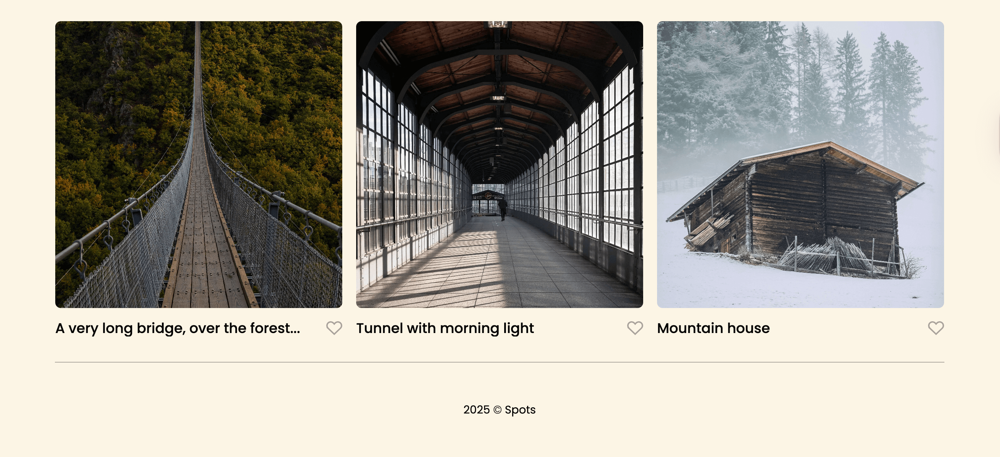

# Spots

A photo-sharing website for beautiful scenery experiences.

## Description

This site lets users create a personal profile page. The profile displays a photo gallery with three images per row. Users can click a heart icon under any image to show they like it.

## 🛠️ Tech Stack

This project was built using standard frontend tools and clean code principles.

### Core Languages

- **HTML5:** Used to build the structure of the website, forms, and popup windows.
- **CSS3:** Handles the page layout, CSS Grid, media queries for responsiveness, and error styling.
- **JavaScript (ES6+):** Runs the interactive form validation and manages the submit button behavior.

### Development Tools

- **VS Code & Git:** Used for writing code and saving project updates to GitHub.
- **GitHub Copilot & Dot:** Utilized responsibly as AI assistants to help troubleshoot logic bugs and errors.

## Screenshots

## Deployment

This webpage is deployed to GitHub Pages:

[Deployment Link](https://nayeliglover.github.io/se_project_spots/)

## Project Pitch Videos

Check out these walkthrough videos describing the project:

- [project-Spots2](https://drive.google.com/file/d/1ZCeYFl3tF2_NcQ1Rm62D_qVqOSU_f0Qj/view?usp=sharing)
- [Project-SpotsStage9](https://drive.google.com/file/d/1x_khye2H56rB8X_qn9qiYuKFmOUfZBS_/view?usp=sharing)
